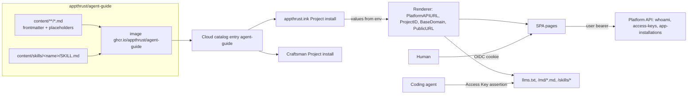

# Agent Guide: a marketplace app that teaches coding agents to operate AppThrust

Status: design 2026-11-09 (owner request: "a page on the platform that makes
AppThrust easy for AGENTS to operate through `apth`/`apthctl`, built from
AppThrust knowledge, shipped as a marketplace app to appthrust.ink and
Craftsman").

## Problem

A coding agent (Claude Code, Codex, OMP) that is asked to "deploy this to
AppThrust" or "why is my app not Ready" has no environment-bound entry point:

- `apth skills install` ships one skill (`appthrust-app-dev`) that hardcodes
  `https://dashboard.appthrust.dev` and `pj-af59d1dc379b`; on appthrust.ink or
  Craftsman the agent guesses the wrong environment.
- The knowledge that makes `apth`/`apthctl` usable (wait semantics, 401/409
  handling, `follow` vs `pinned`, "Pod Ready is not product Ready", lease and
  authority rules) is spread over `apth-cli/README.md`, repo `skills/apthctl-*`,
  `docs/`, and the Nexus vault, none of which an agent on a customer laptop can
  read.
- Nothing is machine-readable: there is no `llms.txt`, no raw-Markdown route,
  no skills index an agent can fetch with a credential it already has.

## Decision

Ship **Agent Guide** (`slug: agent-guide`) as a first-party marketplace app
(ADR-0072 path: own repository `appthrust/agent-guide` → `ghcr.io/appthrust/
agent-guide` → Cloud catalog → `AppCatalogSource` on every platform). It needs
no platform change, so it reaches appthrust.ink and Craftsman through the
catalog alone and does not depend on the Craftsman rc16 lane.

| # | Decision | Why |
| --- | --- | --- |
| D1 | Marketplace app, not a Project Addon, not a Dashboard page | Project Addons are frozen vocabulary (ADR-0072); a Dashboard page would ride the platform release cadence and reach Craftsman only via rc16. The catalog reaches both estates within ~15 min of publish. |
| D2 | Content is **curated Markdown embedded in the image**, rendered with the installation's real values at serve time | The same image is correct on every estate: `PLATFORM_API_URL`, `PLATFORM_PROJECT_ID`, and the public URL arrive through the `platform` ComponentConnection and `AGENT_GUIDE_PUBLIC_URL`. No database: content is release-versioned, not user data. |
| D3 | Every document is served as HTML (SPA) **and** as raw Markdown; the app exposes `llms.txt`, `llms-full.txt`, and a skills index | Agents read text, humans read pages. One content tree, two renderers. |
| D4 | Agents authenticate with an **Access Key** (`access.accessKeys`, scope `read`) exchanged for a short-lived assertion; humans use the OIDC edge cookie | Reuses the existing `knowledge` convention (`apth access-keys create --space agent-guide --scope read --env`, `apth access-keys exchange`); `bearerPassThrough: true` lets the assertion pass the edge. No new platform auth path; apth never prints a user token by design. |
| D5 | The SPA's **Agent setup** panel renders the exact `apth access-keys create --project <id> --space agent-guide --scope read --label <label> --env` command and the follow-up exchange/curl block; it does not call the Platform API itself | First-party SPAs never hold a bearer: the OIDC edge attaches it per request and the browser session is a cookie scoped to the app origin (`knowledge/web/src/api/knowledge.ts:134-137`). The key secret therefore appears only in the user's terminal, never in the app. |
| D6 | Two audiences in one content tree: `developer` (`apth`) and `operator` (`apthctl`); the operator track is informational and states required authority, it never embeds credentials or estate names | The owner asked for both; `apthctl` paths need Gateway/kubeconfig authority the app cannot and must not grant. |
| D7 | Content carries `sources[]` (platform path + revision) and the app repo has `hack/check-sources.ts` that fails CI when a source path no longer exists at the pinned revision | Staleness is the main failure mode of hand-curated knowledge; make it visible, not silent. Full automatic sync is out of scope. |

## Domain model



| Entity | Owner | Lifecycle | Invariants |
| --- | --- | --- | --- |
| `Document` | app repo (`content/`) | released with the image | `slug` = path without `content/` and `.md`; frontmatter `title`, `summary`, `audience: developer\|operator\|both`, `section`, `order`, `tags[]`, `sources[]{path,revision}`; body is Go `text/template` over `Values` |
| `Skill` | app repo (`content/skills/<name>/`) | released with the image | directory with `SKILL.md` (+ optional `references/*`); `SKILL.md` frontmatter follows the agent-skill convention (`name`, `description`); rendered with the same `Values` |
| `Values` | server, from env | per process | `PlatformAPIURL` (env `PLATFORM_API_URL`), `ProjectID` (`PLATFORM_PROJECT_ID`), `PublicURL` (`AGENT_GUIDE_PUBLIC_URL`), `BaseDomain` (host of `PublicURL` with `agent-guide.<project>.` removed), `ReleaseVersion` (`AGENT_GUIDE_RELEASE_VERSION`), `AccessURL` (= `PlatformAPIURL`: the origin `apth access-keys exchange --access-url` POSTs `/api/v1/access/token` to, `sdk/access.go:259`; `apth access-keys create --env` emits it as `AGENT_GUIDE_ACCESS_URL`, `apth-cli/internal/cmd/apth/accesskeys.go:137-138`) |
| `Context` | Platform API, read with the caller's bearer | per request | `me{login, role}`, `installations[]{name, version, url, phase}`; absent (403) for Access Key subjects |
| Access Key space `agent-guide` | platform (definition `access.accessKeys`) | platform-owned | scope `read` only; `defaultTTL 720h`, `maxTTL 8760h`, `keyPrefix agg` |

Ownership boundaries: the app writes nothing to the platform; the Access Key
is created by the user through `apth` with their own bearer. The
app holds no service credential and has no database.

## Contracts

### Repository layout (mirrors `appthrust/memo` minus the database)

```
agent-guide/
  go.mod                      module github.com/appthrust/agent-guide; requires github.com/appthrust/appserver-go
  cmd/server/                 main.go, server.go (routes), internal/{content,render,api}
  content/                    Markdown tree (see "Content tree")
  web/                        Vite + React SPA (@appthrust/app-launcher, @appthrust/platform-dashboard-i18n)
  catalog/entry.yaml          ApplicationStackDefinition document
  catalog/listing.yaml        appthrust.com listing (+ catalog/screenshots/*.webp)
  hack/publish-entry.ts       copied from memo (submit / await / validate-listing / listing)
  hack/check-sources.ts       D7 source-staleness check
  Dockerfile                  stage web (bun build:image) + stage server (go build) → distroless static, USER 65532, EXPOSE 8080
  .github/workflows/{ci.yml,publish.yml,catalog-listing.yml}
  docs/design.md              this file
```

### `catalog/entry.yaml`

```yaml
apiVersion: appthrust.io/v1alpha1
kind: ApplicationStackDefinition
metadata: { name: agent-guide }
spec:
  display: { title: Agent Guide, category: develop, iconRef: { name: terminal },
             description: Environment-bound guide, skills and llms.txt that teach coding agents to operate this AppThrust Project with apth and apthctl. }
  components:
    - id: web
      definitionRef: { name: web-service, version: v1 }
      defaultValues: { port: 8080, minScale: 1, readinessProbePath: /readyz, livenessProbePath: /healthz, publicURLEnv: AGENT_GUIDE_PUBLIC_URL }
  publish: { hostnameLabel: agent-guide }
  access:
    audiences: [appthrust-platform-api]
    scopes: [openid, profile, email]
    tokenClaims: [groups]
    bearerPassThrough: true
    accessKeys:
      audience: agent-guide
      audienceEnv: AGENT_GUIDE_ACCESS_AUDIENCE
      keyPrefix: agg
      scopes: [{ name: read, description: Read guide documents, skills and llms.txt }]
      defaultConnectionScopes: [read]
      defaultTTL: 720h0m0s
      maxTTL: 8760h0m0s
  releaseIdentityEnvPrefix: AGENT_GUIDE
  updatePolicy: { default: follow, allowed: [follow, pinned] }
  versions: []        # written by hack/publish-entry.ts on tag
```

`iconRef.name: terminal` is a bundled Dashboard launcher icon key
(`dashboard/packages/app-launcher/src/icons.ts:18-32`); unknown keys fall back to
`puzzle`.

### HTTP surface (server)

| Route | Auth | Response |
| --- | --- | --- |
| `GET /healthz`, `GET /readyz` | none | 200 once content is parsed (readyz 503 while parsing/invalid) |
| `GET /releasez` | none | `releaseidentity.NewHandler("AGENT_GUIDE", …)` |
| `GET /config` | none | `{ "projectId", "publicUrl" }` (memo convention) |
| `GET /launcher` | bearer | `launcher.NewHandler` (memo convention) |
| `GET /llms.txt` | bearer (user or key) | Markdown index: title, one-line purpose, then `- [title](<PublicURL>/md/<slug>.md): summary` grouped by section, and a `## Skills` list of `<PublicURL>/skills/<name>/SKILL.md` |
| `GET /llms-full.txt` | bearer | every document, rendered, concatenated in `(section, order)` order with `# <title>` headers |
| `GET /md/{slug...}.md` | bearer | rendered Markdown, `Content-Type: text/markdown; charset=utf-8` |
| `GET /skills/index.json` | bearer | `{ "skills": [{ "name", "description", "files": ["SKILL.md", …] }] }` |
| `GET /skills/{name}/{file...}` | bearer | rendered file; `SKILL.md` is `text/markdown` |
| `GET /api/agent-guide/v1/config` | bearer | `{ projectId, publicUrl, platformApiUrl, baseDomain, accessUrl, releaseVersion }` |
| `GET /api/agent-guide/v1/docs` | bearer | `{ "docs": [{ slug, title, summary, audience, section, order, tags }] }` sorted `(section order, order, title)` |
| `GET /api/agent-guide/v1/docs/{slug...}` | bearer | `{ slug, title, summary, audience, section, tags, sources, markdown }` (`markdown` already rendered; SPA renders to HTML with `marked` + `dompurify`) |
| `GET /api/agent-guide/v1/skills` | bearer | same as `/skills/index.json` |
| `GET /api/agent-guide/v1/context` | user bearer only | `{ me: { login, role }, installations: [{ name, version, url, phase }] }`; `403 key_subject` for Access Key assertions; `503 platform_unavailable` when Platform API fails |
| `GET /` and SPA routes | edge cookie | SPA from `--static-dir` (default `/srv/agent-guide`), history fallback |

Error envelope: `appserver/httpx` (`WriteError(w, err, "agent-guide")`).
Authentication: `identity.New(identity.FromEnv("AGENT_GUIDE"))` exactly as
`knowledge` (`cmd/server/server.go:48`), which accepts both the OIDC issuer and
`PLATFORM_ACCESS_ISSUER` assertions with audience `AGENT_GUIDE_ACCESS_AUDIENCE`.
`/context` uses `appserver/platformclient` with the caller's bearer forwarded
verbatim; it never caches across subjects.

Rendering: Go `text/template` with `Values`; delimiters `{{` `}}`; missing
key is a startup error (content is validated at boot and in `go test`).
Markdown must stay valid after rendering (placeholders are URLs/identifiers
only).

### Content tree (slice C owns `content/`)

```
content/
  start-here.md                        section 0 "Start here"       both
  apth/install.md                      section 1 "apth"             developer
  apth/login-and-profiles.md
  apth/cookbook/apps.md                create / get / env / logs / publish / delete
  apth/cookbook/components-and-releases.md
  apth/cookbook/databases.md
  apth/cookbook/marketplace-apps.md    app-installations, follow vs pinned, retry-release
  apth/cookbook/access-keys.md
  apth/cookbook/operations-and-waits.md
  apth/troubleshooting.md              401 hint, 409 delivery_pending vs delivery_blocked, not Ready ladder
  apthctl/overview.md                  section 2 "apthctl (operators)" operator
  apthctl/pmc-update-and-releases.md
  apthctl/debug.md
  apthctl/authority-and-leases.md
  concepts/model.md                    section 3 "Concepts"         both: Project, Application, Component, Stack, Publish, Marketplace, Operation
  concepts/readiness.md                Pod Ready ≠ product Ready; settled; probes
  lessons/*.md                         section 4 "Lessons"          both: distilled vault lessons, each with sources[]
  skills/appthrust-app-dev/SKILL.md    env-bound rewrite of apth-cli/skills/appthrust-app-dev
  skills/appthrust-marketplace-apps/SKILL.md
  skills/appthrust-operator-apthctl/SKILL.md
```

Frontmatter example:

```yaml
---
title: Log in and choose a Project
summary: Device login against this environment's Platform API and profile selection.
audience: developer
section: apth
order: 20
tags: [auth, profiles]
sources:
  - { path: apth-cli/README.md, revision: <platform main sha at authoring> }
---
Run `apth login --api-url {{.PlatformAPIURL}} --project {{.ProjectID}}` …
```

Rules for content: `apth` first, never raw `curl` against the Platform API
when a command exists; never print or paste tokens; every destructive command
shows `--yes`; every wait shows `--wait --timeout`; environment values are
placeholders, never literal estate hostnames or project IDs; Japanese and
English copy for the SPA chrome only — documents are English (agents read
English; the platform's docs are English).

### SPA (slice B owns `web/`)

Routes: `/` (Start here + Agent setup panel), `/docs/$slug` (document, with a
"Copy as Markdown" and "Raw .md" link), `/skills` (list; each with install
snippet), `/llms` (shows `llms.txt` with copy button). Left nav grouped by
section with the audience badge. Shell: `@appthrust/app-launcher`, i18n ja/en
for chrome via `@appthrust/platform-dashboard-i18n`.

Agent setup panel: shows `apth login --api-url <platformApiUrl> --project
<projectId>`; button "Create an Access Key for an agent" → `POST` Platform API
access key create (`space: agent-guide`, `scope: read`, label from input) with
the session bearer → shows a one-time block:

```bash
export AGENT_GUIDE_ACCESS_URL=<accessUrl>
export AGENT_GUIDE_API_KEY=agg_…            # shown once
apth access-keys exchange --access-url "$AGENT_GUIDE_ACCESS_URL" <<<"$AGENT_GUIDE_API_KEY"   # prints a short-lived assertion
curl -fsSL -H "Authorization: Bearer <assertion>" "$AGENT_GUIDE_ACCESS_URL/llms.txt"
```

The exact Platform API route/shape for key creation is read from
`platform/sdk/access.go` (`CreateAccessKey`) and `apth-cli` `access-keys create`;
the SPA uses `@appthrust/api-schema` if the route is in the oRPC contract, else
a typed fetch wrapper in `web/src/api/platform.ts` (only place allowed to call
the Platform API). Secrets are never written to storage or logs.

## Delivery

1. Repo `appthrust/agent-guide` (public), secrets/vars as memo
   (`CLOUD_CATALOG_ADMIN_TOKEN`, `CLOUD_API_URL`, org App private key).
2. Tag `v0.1.0` → `publish.yml` → image + cosign → `PUT entries/agent-guide` →
   `POST publish` → signed catalog.
3. appthrust.ink: `apth app-installations create agent-guide` on the proof
   Project; readback `https://agent-guide.<project>.appthrust.ink/releasez`
   (fresh connection), signed-in SPA, and `llms.txt` through an Access Key.
4. Craftsman: same install on the Craftsman Project once its
   `AppCatalogSource` shows the entry; independent of the rc16 lane (no
   platform change in this app).

## Out of scope / follow-ups

- `apth guide` / `apth skills install --from <url>` (platform PR; would let an
  agent pull skills with its stored token instead of an Access Key).
- Automatic content sync from the platform repository.
- A dedicated `agent-guide` launcher icon key in the Dashboard (platform PR).
